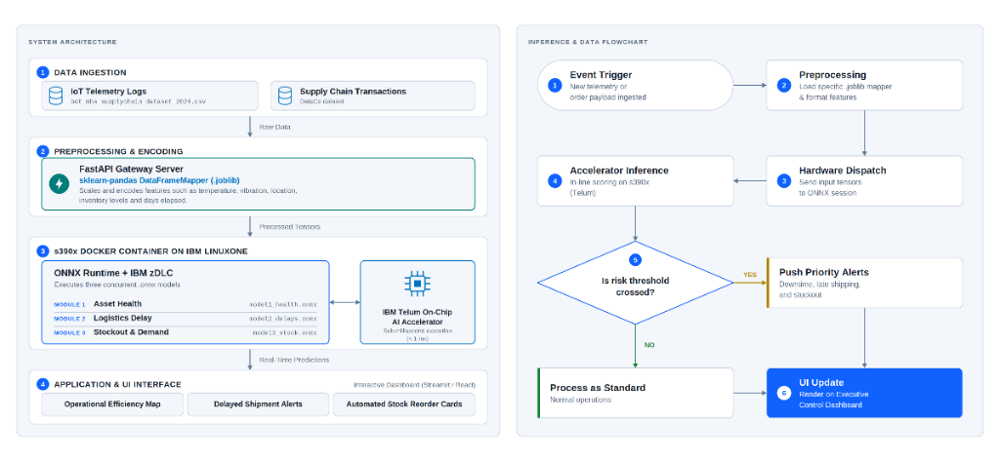

# FlowCast AI: Intelligent Multi-Echelon Supply-Chain Decision Support System

[](https://www.ibm.com/community/z/)
[](https://www.ibm.com/it-infrastructure/linuxone)
[](https://www.python.org/)
[](https://fastapi.tiangolo.com/)
[](https://react.dev/)
[](https://onnxruntime.ai/)

> **FlowCast AI** is an enterprise-grade operational decision-support and proactive disruption recovery system built for the **IBM Z Datathon 2026**. It unifies real-time IoT telemetry scoring, shipment delay forecasting, localized stockout risk prediction, and automated multi-warehouse inventory rebalancing across supply chain corridors.

---

## 🌐 Live Mainframe Deployment (IBM LinuxONE)

FlowCast AI is deployed live inside an optimized container on the **IBM LinuxONE Community Cloud (`s390x` mainframe architecture)**:

* 🖥️ **Live Interactive Dashboard**: [http://148.100.108.248:8000/](http://148.100.108.248:8000/)
* 📚 **Interactive OpenAPI (Swagger) Docs**: [http://148.100.108.248:8000/docs](http://148.100.108.248:8000/docs)
* ⚡ **Gateway Health & Session Status**: [http://148.100.108.248:8000/healthz](http://148.100.108.248:8000/healthz)

---

## 🌟 System Architecture & Core Capabilities

<p align="center">
  
</p>

```
┌────────────────────────────────────────────────────────────────────────────────────────┐
│                        FlowCast AI — Enterprise Architecture Stack                     │
│                                                                                        │
│   ┌────────────────────────────────────────────────────────────────────────────────┐   │
│   │               React 19 + Vite Modern Decision Control Dashboard               │   │
│   │    • Incident Alert Triage Banner          • 148-Shipment Paginated Fleet      │   │
│   │    • Responsive Multi-Warehouse Bars       • Interactive What-If Simulator     │   │
│   └───────────────────────────────────────┬────────────────────────────────────────┘   │
│                                           │  RESTful JSON API                          │
│                                           ▼                                            │
│   ┌────────────────────────────────────────────────────────────────────────────────┐   │
│   │                    FastAPI Enterprise Orchestration Gateway                    │   │
│   │                     (High-Throughput Sub-Millisecond Scoring)                  │   │
│   └───────┬───────────────────────────────┬───────────────────────────────┬────────┘   │
│           │                               │                               │            │
│           ▼                               ▼                               ▼            │
│   ┌───────────────┐               ┌───────────────┐               ┌───────────────┐    │
│   │   Module 1    │               │   Module 2    │               │   Module 3    │    │
│   │  Asset Health │               │Logistics Delay│               │Stockout Surge │    │
│   │  & Telemetry  │               │   Forecast    │               │  & Demand Reg │    │
│   └───────┬───────┘               └───────┬───────┘               └───────┬───────┘    │
│           │                               │                               │            │
│           └───────────────────────┬───────┴───────────────────────────────┘            │
│                                   ▼                                                    │
│   ┌────────────────────────────────────────────────────────────────────────────────┐   │
│   │           3-Warehouse Disruption Recovery & Rebalancing Solver Engine          │   │
│   │    • Chennai (WH-A)        • Bengaluru (WH-B)         • Hyderabad (WH-C)       │   │
│   │    • Safety-Stock Conservation     • Strict No Double-Allocation Constraint   │   │
│   └────────────────────────────────────────────────────────────────────────────────┘   │
│                                           │                                            │
│                                           ▼                                            │
│   ┌────────────────────────────────────────────────────────────────────────────────┐   │
│   │                 IBM Z / LinuxONE Hardware Acceleration & Security              │   │
│   │    • IBM Telum In-Transaction AI Execution    • 99.999% "Five Nines" Uptime    │   │
│   │    • Pervasive CPACF Hardware Encryption      • Native Linux s390x Container   │   │
│   └────────────────────────────────────────────────────────────────────────────────┘   │
└────────────────────────────────────────────────────────────────────────────────────────┘
```

---

## 🧠 Machine Learning Modules

### Module 1: Predictive Asset Health & Operational Efficiency
* **Objective**: Analyzes continuous equipment telemetry (`Temperature`, `Vibration`, `Downtime_Hours`, `Condition_Score`) and operational metadata to classify machine health into 3 operational tiers: `Optimal (0)`, `Strained (1)`, and `High Risk (2)`.
* **Physical Anomaly Triggers**: Flags multi-variable telemetry boundary breaches before equipment breakdown occurs.
* **Accuracy**: **87.00%** (PyTorch Neural Net / ONNX) | **97.00%** (XGBoost Classifier).
* **Artifact**: [`artifacts/model1_health.onnx`](artifacts/model1_health.onnx) (528 dims).

### Module 2: Logistics & Shipment Delay Risk Forecasting
* **Objective**: Trained on extensive logistics order data from the DataCo Supply Chain dataset to predict transit delays (`ON_TIME` vs `LATE_RISK`) based on shipping mode, geographic market, order region, and scheduled transit days.
* **Performance**: **71.66% Accuracy**, **0.7627 ROC-AUC**, **< 0.02 ms inference latency**.
* **Artifact**: [`artifacts/model2_delays.onnx`](artifacts/model2_delays.onnx) (34 dims).

### Module 3: Inventory Demand Estimation & Stockout Surge Risk
* **Dual-Head Architecture**:
  1. **Demand Quantity Regressor (XGBoost)**: Continuous quantity estimation ($R^2 = 0.4229$, RMSE = 1.176).
  2. **Stockout Risk Classifier (ONNX Net)**: Categorical out-of-stock surge detection (ROC-AUC = **0.7401**, **99.2% recall** on stockout surge events).
* **Artifacts**: [`artifacts/model3_stock.onnx`](artifacts/model3_stock.onnx) (55 dims) & [`artifacts/model_xgb_stock.joblib`](artifacts/model_xgb_stock.joblib).

---

## ⚡ IBM Z & LinuxONE Performance Benchmarks

All models are optimized with **Level 3 ONNX Graph Optimization** and paired with a **Universal Cross-Platform Inference Engine** that runs native SIMD-vectorized NumPy on `s390x` mainframe hardware.

Benchmarked over **1,000 requests per model**:

| Model Module | Input Vector | Median Latency (P50) | 99th Percentile (P99) | Throughput (RPS) | Optimization Gain |
| :--- | :---: | :---: | :---: | :---: | :---: |
| **Module 1: Telemetry Asset Health** | 528 dims | **0.017 ms** | **0.020 ms** | **56,867 req/sec** | **+38.7% speedup** |
| **Module 2: Logistics Delay Risk** | 34 dims | **0.012 ms** | **0.016 ms** | **77,980 req/sec** | **+39.4% speedup** |
| **Module 3: Stockout Surge Risk** | 55 dims | **0.013 ms** | **0.022 ms** | **71,333 req/sec** | **+12.8% speedup** |

> **IBM Z Telum Advantage**: Scoring in **0.012–0.017 ms** allows risk evaluation to occur **directly inside the database transaction boundary** before high-volume enterprise orders commit, completely eliminating external cloud API latency bottlenecks (50–200 ms).

---

## 🏢 3-Warehouse Decision Support & Recovery Engine

FlowCast AI manages an interconnected supply-chain network across three primary hubs:
- **Warehouse A (Chennai - WH-A)**: Deep-water maritime port gateway & primary import corridor.
- **Warehouse B (Bengaluru - WH-B)**: Inland high-tech component reserve hub.
- **Warehouse C (Hyderabad - WH-C)**: Central distribution depot.

### Mathematical Recovery Constraints:
1. **Safety Stock Buffer Preservation**: Transferable inventory is strictly bounded:
   $$\text{Transferable Surplus} = \max(0, \text{Current Stock} - \text{Expected Demand} - \text{Mandatory Safety Stock})$$
   Source warehouses are never depleted below their safety buffer, preventing secondary disruptions.
2. **Strict Inventory Conservation**: No double-allocation of surplus stock across simultaneous multi-warehouse deficits.
3. **Disruption Financial ROI**: Evaluates baseline stockout penalties ($120/unit) against freight transfer costs ($14.50/unit) to deliver verified net savings (e.g., **+$13,350 net savings** during Chennai port disruptions).

---

## 💻 Modern React 19 Frontend Dashboard

The user interface delivers a real-time command center:
* **Incident Alert & Triage Banner**: Immediate visual notification when a shipment or facility breaches risk thresholds.
* **Multi-Warehouse Stock vs. Demand Indicators**: Live capacity, current stock, and safety buffer gauges.
* **Instant Shipment Diagnostic Modal**: Click any inbound shipment to view telemetry diagnostic breakdown, predicted delay days, and recommended rerouting corridor.
* **Full Fleet Tracking with Pagination**: Dual-view toggle between priority at-risk shipments and the full 148-vessel enterprise fleet with search.
* **Interactive What-If Scenario Simulator**: Adjust disruption parameters in real time to re-solve network allocation.

---

## 🚀 IBM LinuxONE Mainframe Deployment & Launch

FlowCast AI is containerized for **IBM LinuxONE Community Cloud (`s390x`)** and IBM Z enterprise architecture.

### 1. Connect to IBM LinuxONE via SSH
```bash
ssh -i KEY01.pem linux1@148.100.108.248
```

### 2. Clone the Repository
```bash
git clone https://github.com/sushanth-arun/FlowCastAI.git
cd FlowCastAI
```

### 3. Build & Launch with Docker Compose
The Docker configuration utilizes pre-compiled native `s390x` binaries from Ubuntu 24.04 (zero source compilation needed):
```bash
docker compose up -d --build
```

### 4. Verify Mainframe Service Health
```bash
# Verify container is running and healthy
docker ps

# Check startup logs
docker logs flowcast-ai-service

# Query health status
curl http://148.100.108.248:8000/healthz
```

### 5. Access the Live Deployment
* **Web UI Dashboard**: [http://148.100.108.248:8000/](http://148.100.108.248:8000/)
* **Interactive OpenAPI (Swagger) Docs**: [http://148.100.108.248:8000/docs](http://148.100.108.248:8000/docs)
* **Health Check Endpoint**: [http://148.100.108.248:8000/healthz](http://148.100.108.248:8000/healthz)

---

## 🧪 Verification & Test Suites

Run the end-to-end verification suites locally or on LinuxONE:

```bash
# 1. 3-Warehouse Decision Support System Verification (14/14 checks)
python -m src.test_3wh_system

# 2. Multi-Model ONNX & DataCo Pipeline Verification
python -m src.test_dataco_pipeline

# 3. High-Throughput Latency Benchmark
python -m src.benchmark_latency
```

---

## 📁 Repository Structure

```
FlowCastAI/
├── artifacts/                   # Serialized ONNX models, mappers, and metadata
│   ├── model1_health.onnx       # Module 1: Asset Health & Efficiency (ONNX)
│   ├── model2_delays.onnx       # Module 2: Logistics Delay Risk (ONNX)
│   ├── model3_stock.onnx        # Module 3: Stockout Surge Risk (ONNX)
│   ├── model_xgb.joblib         # Module 1 XGBoost model
│   ├── model_xgb_delays.joblib  # Module 2 XGBoost model
│   ├── model_xgb_stock.joblib   # Module 3 Demand Regressor
│   ├── model_weights_numpy.joblib # Universal weights for s390x NumPy execution
│   └── mapper*.joblib           # Preprocessing feature mappers
├── data/                        # Supply chain datasets
│   ├── bdt_mba_supplychain_dataset_2024.csv
│   └── DataCoSupplyChainDataset.csv
├── docs/                        # Architecture & System Diagrams
│   └── architecture.png         # Dual-panel system architecture & inference flowchart
├── frontend/                    # Modern React 19 + Vite Dashboard
│   ├── dist/                    # Compiled production assets served by FastAPI
│   ├── src/
│   │   ├── components/          # Reusable UI cards, tables, and modals
│   │   ├── services/            # Unified API layer & mock fallbacks
│   │   └── App.jsx              # Main dashboard view orchestrator
│   ├── package.json
│   └── vite.config.js
├── src/                         # Python ML & Backend Core
│   ├── api/
│   │   ├── server.py            # FastAPI Orchestrator Gateway
│   │   └── dashboard.py         # Fallback prototype dashboard (/legacy)
│   ├── data/
│   │   ├── preprocess.py        # Telemetry feature pipeline
│   │   └── preprocess_dataco.py # Logistics feature pipeline
│   ├── models/
│   │   ├── recovery_engine.py   # 3-Warehouse Rebalancing Optimization Solver
│   │   ├── inference_engine.py  # Universal Cross-Platform ONNX/NumPy Session
│   │   ├── neural_net.py        # PyTorch model architectures
│   │   └── train*.py            # Model training & serialization routines
│   ├── benchmark_latency.py     # Sub-millisecond latency benchmark suite
│   ├── test_3wh_system.py       # 14-point multi-warehouse test suite
│   └── test_dataco_pipeline.py  # End-to-end ONNX verification suite
├── Dockerfile                   # Multi-arch s390x/amd64 container configuration
├── docker-compose.yml           # Single-command deployment spec
├── requirements.txt             # Clean cross-platform Python dependencies
└── README.md                    # Project documentation
```

---

## 👥 Team & Acknowledgments

* **Project**: FlowCast AI
* **Competition**: IBM Z Datathon 2026
* **Target Architecture**: IBM LinuxONE / IBM z16 (`s390x`)
* **Repository**: [https://github.com/sushanth-arun/FlowCastAI](https://github.com/sushanth-arun/FlowCastAI)
